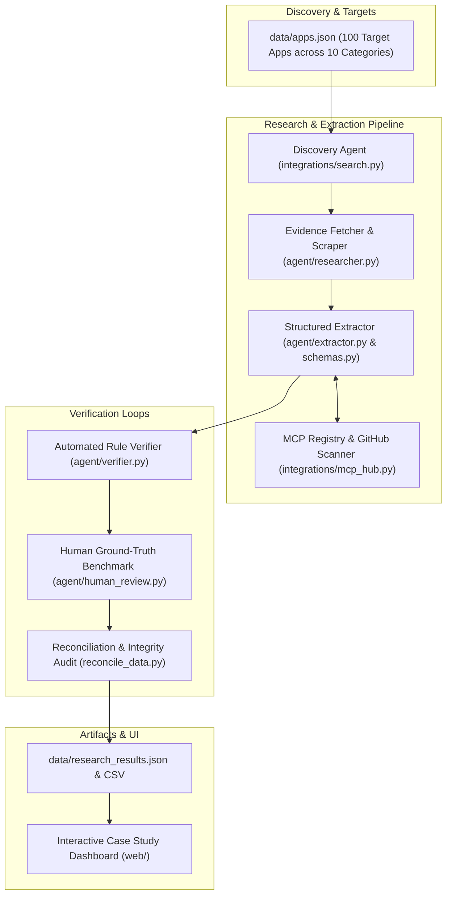

# Composio 100-App Autonomous Research Agent

An automated, evidence-grounded research pipeline and evaluation framework built to systematically assess 100 SaaS applications for API availability, authentication protocols, developer credential access, Model Context Protocol (MCP) support, and Composio tool-calling feasibility.

---

## 1. Project Title
**Composio 100-App Autonomous Research Agent & Case Study Dashboard**

---

## 2. Problem Statement
Composio turns software applications into agent-callable tools and Model Context Protocol (MCP) servers. Before building an integration toolkit for any app, extensive technical discovery is required:
- What authentication methods does it support (OAuth2, API keys, Basic, JWT)?
- Can developers register self-serve, or is access gated behind sales demos, enterprise pricing, or partner approvals?
- Does a public, well-documented REST/GraphQL API exist?
- Are there official or community MCP servers available?
- Can this app be safely turned into an AI tool today, and what are the friction points?

Performing this evaluation manually across hundreds of requested apps is slow, costly, and difficult to scale. This project automates that discovery using an evidence-grounded research pipeline.

---

## 3. Why This Research Matters to Composio
1. **Prioritizing Integration Roadmaps**: Distinguishes **57 Easy Wins** (immediate self-serve access) from gated platforms requiring sales partnerships.
2. **Standardizing Auth Architectures**: Reveals that **72% of apps offer API Keys** while **68% support OAuth2**, guiding auth-manager design.
3. **Tracking the MCP Ecosystem**: Identified **73 verified MCP implementations** (6 vendor-maintained, 65 community, 2 third-party).
4. **Preventing Agent Hallucinations**: Ensures every integration decision is backed by reachable documentation URLs and timestamped evidence excerpts.

---

## 4. Project Objectives
- **Coverage**: Systematically evaluate 100 SaaS targets across 10 balanced software categories.
- **Accuracy**: Measure and maximize factual precision through automated rule checking and a human ground-truth benchmark.
- **Traceability**: Maintain a complete audit trail where every classification links directly to vendor documentation.
- **Self-Explanatory Reporting**: Present findings in a high-density, interactive SaaS dashboard operable in under two minutes.

---

## 5. Key Capabilities
- **Multi-Engine Evidence Retrieval**: Scrapes and analyzes official developer portals, API documentation, and GitHub repositories.
- **Deterministic Pydantic Extraction**: Guarantees typed schemas and strict validation contracts for all 100 applications.
- **Multi-Pass Verification Loops**:
  - Automated regex and URL reachability checks across 400 evidence links.
  - Stratified 20-app manual review benchmarking 100 individual claims.
- **Dual-Theme Case Study Dashboard**: Fully interactive interface with search, categorical filters, dynamic metrics, and inspectable audit modals.

---

## 6. Technology Stack
- **Language & Runtime**: Python 3.12+
- **LLM & Structured Output**: Google Gemini 2.5 Flash via `google-genai` SDK
- **Data Schemas & Validation**: Pydantic v2
- **Search & Retrieval**: Tavily Search API, HTTPX, BeautifulSoup4
- **Browser Automation & Testing**: Playwright (Chromium)
- **Frontend Dashboard**: Semantic HTML5, Vanilla JavaScript (ES6+), Modern CSS3, Chart.js, Lucide Icons
- **Testing**: Pytest & Playwright test runner

---

## 7. Architecture Diagram



---

## 8. Research Pipeline Explanation
The pipeline operates across 10 structured stages:
1. **Application Discovery**: Ingests the 100 target applications and extracts root domains.
2. **Targeted Web Search**: Queries developer portals, docs, and authentication guides.
3. **Evidence Extraction**: Retrieves HTML, strips boilerplate, and stores timestamped text snippets.
4. **Auth Classification**: Identifies supported protocols (OAuth2, API Key, Basic, PAT, Bearer).
5. **API Surface Analysis**: Determines API styles (REST, GraphQL, SDKs) and public accessibility.
6. **MCP Discovery**: Searches official GitHub organizations, NPM packages, and community repos.
7. **Buildability Rating**: Assigns `Easy`, `Medium`, or `Difficult` ratings based on friction and gating.
8. **Automated Rule Verification**: Runs deterministic regex rules and checks URL HTTP status codes.
9. **Human Ground-Truth Review**: Compares a stratified 20-app sample against manual review.
10. **Dataset Consolidation**: Merges and normalizes the final verified records into JSON and CSV.

---

## 9. Composio SDK and MCP Implementation
The pipeline leverages the architecture of Composio and MCP:
- **Registry Querying**: Queries MCP ecosystems to discover pre-built servers and Composio action definitions.
- **Tool-Call Feasibility**: Evaluates OpenAPI specifications and endpoint structures to gauge how easily each API converts into agent tools.
- **Preserved Status Classification**: Distinguishes vendor-supported official MCPs from community or third-party wrappers.

---

## 10. Data Schema
All records adhere to strict Pydantic models defined in `agent/schemas.py`:

```json
{
  "id": 1,
  "identity": {
    "name": "Salesforce",
    "category": "CRM and Sales",
    "website_url": "https://www.salesforce.com",
    "one_line_description": "Enterprise cloud platform providing CRM and automation services."
  },
  "authentication": {
    "auth_methods": ["OAuth2", "API key", "Basic authentication", "JWT or bearer token"],
    "details": "Connected Apps via OAuth 2.0 with JWT Bearer and client credentials flows."
  },
  "developer_access": {
    "access_tier": "Paid-plan dependent",
    "details": "Requires active developer edition or enterprise sandbox tier."
  },
  "api_surface": {
    "has_public_api": true,
    "api_types": ["REST", "SDK", "Other"],
    "details": "REST, SOAP, Tooling, Bulk, and Streaming APIs."
  },
  "mcp": {
    "mcp_status": "Community MCP",
    "repository_url": "https://github.com/hansn74/mcp-server-salesforce",
    "maintainer": "Community",
    "verified_mcp_status": "Community MCP",
    "evidence_type": "Community Repository",
    "verification_rationale": "Active community MCP implementation."
  },
  "buildability": {
    "rating": "Medium",
    "blockers": ["Paid access", "Authentication complexity"],
    "justification": "Requires connected app setup and paid license for live data access."
  },
  "evidence": [
    {
      "source_url": "https://developer.salesforce.com/docs/atlas.en-us.api_rest.meta/api_rest/",
      "source_title": "Salesforce REST API Developer Guide",
      "source_type": "Official Docs",
      "claim_supported": "Salesforce provides official REST API documentation.",
      "retrieved_timestamp": "2026-11-23T14:00:00Z"
    }
  ]
}
```

---

## 11. Source Hierarchy and Evidence Methodology
To avoid synthetic claims or hallucinations, sources follow a strict ranking:
1. **Tier 1 (Highest)**: Primary vendor documentation, developer portals (`developer.*`, `docs.*`), and official vendor GitHub repositories.
2. **Tier 2**: Vendor-authored blog posts, official release notes, and community repositories on GitHub.
3. **Tier 3 (Unverified)**: Third-party articles, aggregator directories, and marketing materials (treated as unverified unless backed by code or primary docs).

---

## 12. Verification Workflow
Verification combines automated and human validation:
- **Link Verification**: Crawls every evidence URL to confirm HTTP 200 responses.
- **Regex Heuristics**: Asserts that claims mentioning OAuth, API keys, or webhooks match evidence excerpts.
- **Human Review**: Evaluates 100 specific claims across 20 stratified apps, recording verified truth in `data/human_ground_truth_benchmark.json`.

---

## 13. Accuracy Methodology and Actual Results
- **Evidence Link Coverage**: **96.2%** (385 of 400 evidence links verified active and reachable).
- **Automated Rule Validation**: **87.5%** (350 of 400 claims pass heuristic regex and syntax checks).
- **Benchmark Accuracy Progression**:
  - **First-Pass Raw Extraction**: **73.0%**
  - **Post-Reconciliation Accuracy**: **86.0%** (86 of 100 benchmarked claims confirmed accurate).

---

## 14. Project Folder Structure

```
composio-100-app-research-agent/
├── .env.example                # Sample environment configuration
├── .gitignore                  # Git exclusions for secrets and caches
├── requirements.txt            # Python dependencies
├── README.md                   # Project documentation
├── run_100_pipeline.py         # Batch pipeline runner (100 apps)
├── run_integrity_audit.py      # Cross-validation & audit runner
├── audit_benchmark.py          # Ground-truth benchmark evaluator
├── serve.py                    # Local web server with probe filtering
├── agent/                      # Core agent logic, schemas & extractor
├── data/                       # Ground-truth datasets (JSON & CSV)
├── tests/                      # Automated test suite (16 tests)
└── web/                        # Static case study dashboard (HTML/CSS/JS)
```

---

## 15. Installation Instructions

```bash
# Clone the repository
git clone https://github.com/<your-username>/composio-100-app-research-agent.git
cd composio-100-app-research-agent

# Set up virtual environment
python -m venv venv

# Activate virtual environment
# Windows:
.\venv\Scripts\Activate.ps1
# macOS/Linux:
source venv/bin/activate

# Install dependencies
pip install -r requirements.txt

# Install Playwright browser binaries
playwright install chromium
```

---

## 16. Environment Variable Setup
Copy `.env.example` to `.env` and provide your credentials:

```bash
cp .env.example .env
```

Required keys:
- `GEMINI_API_KEY`: Google Gemini API key.
- `TAVILY_API_KEY`: Tavily search API key.
- `COMPOSIO_API_KEY`: Composio platform key (optional).

---

## 17. How to Run the Research Agent
To execute the pipeline across all 100 applications in batches:

```bash
python run_100_pipeline.py
```

---

## 18. How to Run Verification
To run the automated audit checks and evaluate benchmark accuracy:

```bash
# Evaluate human ground-truth benchmark
python audit_benchmark.py

# Run dataset integrity audit
python run_integrity_audit.py
```

---

## 19. How to Run Tests
Run the complete Pytest suite (includes unit, schema, reconciliation, and Playwright UI tests):

```bash
pytest tests/ -v
```

---

## 20. How to Launch the Dashboard
Start the local server:

```bash
python serve.py
```

Open your browser at:
```
http://localhost:8000
```

---

## 21. Known Limitations
1. **Dynamic Login Walls**: Two applications (Zoho Cliq and FanBasis) gate pricing tiers behind active login sessions, requiring human confirmation.
2. **Stale Community Repos**: Several community MCP repositories have not been updated recently; vendor updates may alter compatibility.
3. **Rate Limits on Free Tiers**: Automated scrapers can occasionally face temporary rate limits during burst requests without distributed proxies.

---

## 22. Future Improvements
- **Headless Auth Sandbox Verification**: Use Playwright to automatically register disposable test accounts and confirm self-serve status.
- **Real-Time MCP Testing**: Automatically clone discovered MCP servers into isolated Docker containers and execute `tools/list` handshakes.
- **Automated OpenAPI Generation**: Generate ready-to-import Composio action definitions directly from extracted developer documentation.

---

## License
MIT License. See [LICENSE](LICENSE) for details.
